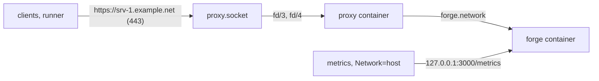

# picolet

**picolet** = **pico** (smaller-than-nano, as in tiny) + **quadlet** -- a tiny Quadlet manager.

A minimal, single-binary GitOps agent for managing Podman Quadlet files on hosts running Podman — a Raspberry Pi, a VPS or any other Linux machine. Think Flux/ArgoCD, but for Podman instead of Kubernetes.

## Installation

### Binary (GitHub Releases)

Download the latest release for your platform from [GitHub Releases](https://github.com/schjan/picolet/releases).
On a Machine you bootstrap, place it at `/usr/local/bin/picolet`, or copy it
out of the image your Fleet pins (the binary is static, at `/picolet`):

```bash
sudo sh -c 'podman run --rm --entrypoint cat ghcr.io/schjan/picolet:<tag> /picolet > /usr/local/bin/picolet'
sudo chmod 0755 /usr/local/bin/picolet
```

This is part of [preparing the Machine](#2-prepare-the-machine).

### Container (GHCR)

```bash
docker pull ghcr.io/schjan/picolet:latest
```

## Quick Start

### Build

Requires [Task](https://taskfile.dev/) (`go install github.com/go-task/task/v3/cmd/task@latest`).

```bash
task build          # native binary
task build-arm64    # cross-compile for RPi
task test           # run tests
task lint           # go vet + gofmt
```

### Validate & Resolve

The `validate` and `resolve` commands require a fleet repository with `fleet.yml`, `assignments.yml`, and host configs. See the fleet repo for details.

```bash
./picolet validate
./picolet resolve --host=srv-1
```

### Build Tags

Picolet uses the Podman Go bindings (`pkg/bindings`) as a pure socket client. The following build tags are required (centralised in `Taskfile.yml`):

| Tag | Purpose |
|-----|---------|
| `remote` | Exclude local libpod engine code — picolet only talks to Podman over the socket API |
| `containers_image_openpgp` | Use pure-Go OpenPGP instead of gpgme (C library) |
| `exclude_graphdriver_btrfs` | Skip btrfs graph driver (C library) |
| `btrfs_noversion` | Skip btrfs version check |
| `exclude_graphdriver_devicemapper` | Skip devicemapper graph driver (C library) |

These tags are also set in the `Containerfile` and `.github/workflows/ci.yml`.

## Deployment

Picolet manages itself via GitOps. `picolet bootstrap machine` gets every Agent
of a Machine running; after that, the Fleet git repo controls everything —
including picolet's own version. Why a Machine runs one Agent per Linux user,
and why bootstrap provisions whole Machines but installs nothing:
[ADR 0002](docs/adr/0002-host-per-linux-user.md).

### 1. Create a Fleet Repository

Use `deploy/fleet-repo/` as a starting point: a worked example of one Machine (`srv-1`) with three Hosts — the default user (`srv-1`), the rootful Host (`srv-1-system`) and an isolated user (`srv-1-runner`); see [Machines, users and ports](#machines-users-and-ports). Your fleet repo needs:

- `fleet.yml` — image versions and ports
- `assignments.yml` — which files go to which hosts
- `hosts/<hostname>/host.yml` — per-host config
- `services/picolet-system/` (rootful) or `services/picolet/` (rootless) — picolet's own Service Bundle: its Quadlet and its config secret

Read [Fleet conventions](#fleet-conventions) before you lay the repository out.

### 2. Prepare the Machine

`picolet bootstrap machine` creates users, sessions, directories, credential
files and the Agents. Everything else stays outside picolet; do it first (by
hand or with your configuration management):

- **Packages.** Podman (`sudo apt install podman`), git for the Fleet
  checkout, and the Proton Pass CLI `pass-cli` if you use
  `--protonpass-pat-file`. Bootstrap installs no packages.
- **The `picolet` binary.** Take the release artifact for the Machine's
  architecture from [GitHub Releases](https://github.com/schjan/picolet/releases),
  or copy it out of the Agent image the Fleet pins (`fleet.yml`
  `images.picolet`; the binary is static):

  ```bash
  sudo sh -c 'podman run --rm --entrypoint cat ghcr.io/schjan/picolet:v0.2.0 /picolet > /usr/local/bin/picolet'
  sudo chmod 0755 /usr/local/bin/picolet
  ```

- **A Fleet checkout** the Hosts' users can reach, e.g.
  `sudo git clone --no-hardlinks <fleet-url> /srv/fleet` (see below for why not
  below `/root` and why `--no-hardlinks`).
- **Firewall.** Every Agent's listener binds loopback by default (see
  [Monitoring](#6-monitoring)); open only the ports your workloads publish,
  e.g. 80 and 443 for the reference `proxy` bundle. Picolet configures no
  firewall.
- **Unprivileged ports.** A rootless Host may bind only ports ≥ 1024 unless
  the Machine sets `net.ipv4.ip_unprivileged_port_start` (e.g. `80` in
  `/etc/sysctl.d/`); set it before assigning a bundle that binds a lower port.
- **SELinux.** On an SELinux-enforcing Machine a container may only use a bind
  mount whose content is labeled for it: add `:z` to the bind mounts
  (`Volume=`) of your Fleet's Quadlets, the Agent quadlet's included. Picolet
  adds no label option, neither to the Fleet's Quadlets nor to the bind mounts
  of the per-Host bootstrap container.

### 3. Bootstrapping a Machine

`picolet bootstrap machine` brings up every Host whose `host.yml` declares a
Machine. Run it on the Machine, with a Fleet checkout there.

First preview:

```bash
picolet bootstrap machine vps-1 --repo-dir /srv/fleet --plan
```

prints every step in execution order, phase by phase (per Host: user,
subuid/subgid ranges, lingering, user manager, `podman.socket`, the four
directories the Agent quadlet bind-mounts, Fleet checkout readable; then
credential files; then the per-Host bootstrap), each marked `would do`,
`already done` or `unknown`. It changes nothing and does not need root; a
check only root can make (another user's `0700` home, `systemctl --user` of
another user) shows as `unknown`, so run it with `sudo` for a definitive plan.

Without `--plan` the command carries the steps out, as root:

```bash
sudo picolet bootstrap machine vps-1 --repo-dir /srv/fleet
```

Every step is checked first and applied only when its end state does not hold,
so a second run applies nothing and an interrupted run resumes. Per rootless
Host it creates the user (`useradd --create-home --shell /usr/sbin/nologin`, no
password, a regular account so it gets subordinate IDs), verifies its
subuid/subgid ranges, enables lingering and waits for the user manager, enables
and starts the user `podman.socket` (a socket that is enabled but not running
is started too), and creates the four directories owned by
the user (never following a symlink out of the home). The rootful Host gets the
system `podman.socket` and its `/etc` and `/var/lib/picolet-system`
directories instead. The Fleet checkout is made readable by every user
(`chmod -R o+rX`); its parent directories must already grant search to others,
so keep it out of `/root` (e.g. `/srv/fleet`), and a hard-linked file that needs
the change stops the step (it would open the other link too: clone with
`git clone --no-hardlinks`). Bootstrap never allocates
subuid/subgid ranges: a user without them stops that Host with the command to
add them (`usermod --add-subuids 100000-165535 --add-subgids 100000-165535 <user>`;
pick a free range if another user holds that one). The other Hosts go on, and
the command exits non-zero.

Credential files come from `--secrets-dir <dir>`, a directory laid out per
Host: every file below `<dir>/<hostname>/` (subdirectories included) is placed
at the same relative path in that Host's secrets directory,
`~<user>/.config/picolet/secrets` for a rootless Host and
`/etc/picolet/secrets` for the rootful one, owned by the Host's user (root for
the rootful Host), mode `0600`. These paths are the Fleet convention the
reference quadlets bind-mount to `/etc/picolet/secrets`; bootstrap does not
read them from `Volume=` lines, and the run prints the path it wrote.
Subdirectories get the Host's owner and `0700`, checked and repaired on every
run. A file already current is left alone; a new or changed one is written and
its Host's Agent restarted (see below); a file with
current content but another owner or mode gets them in place, without a
rewrite or restart. A directory where a file belongs stops that Host with the
advice to remove it; bootstrap removes nothing, and files on the Machine that
`<dir>` does not hold are kept. Only the directories of this Machine's Hosts
are read; other entries of `<dir>` are ignored. A Host without a directory
below `<dir>` gets a warning and the run goes on; within a Host's directory, a
symlink that leads out of `<dir>`, or anything but regular files and
directories, stops the command before its first step, and so does a `<dir>`
inside the Fleet checkout (which bootstrap makes readable by every user).
`--plan` compares the files too and shows each as `would do` (missing, content
differs, owner/mode differ) or `already done`, never their values.

```bash
sudo picolet bootstrap machine vps-1 --repo-dir /srv/fleet --secrets-dir /root/fleet-secrets
```

With a secret provider, pass the Machine's provider token instead of (or beside)
`--secrets-dir`: `--onepassword-token-file <file>` (a 1Password service-account
token) or `--protonpass-pat-file <file>` (a Proton Pass PAT), at most one of
them. The token is placed in every Host's secrets directory like a
`--secrets-dir` file, as `op-service-account-token` or `pp-pat`: the
`onepassword.token_path` / `protonpass.pat_path` the Agent config points at
(`/etc/picolet/secrets/op-service-account-token`,
`/etc/picolet/secrets/pp-pat`). Each Agent then resolves its git token, GitHub
App credentials and every other secret itself, through the references in its
Fleet-rendered config. Scope the token in the vault: one per Machine by default,
or one per Host as the stricter option (see ADR 0002).

```bash
sudo picolet bootstrap machine vps-1 --repo-dir /srv/fleet --onepassword-token-file /root/vps-1-op-token
```

A Host that must run *without* a provider (an isolated CI runner) declares a
`bootstrap:` block instead: file names in its secrets directory and the Secret
Reference each is materialized from. Bootstrap resolves the references of all
Hosts in one batch with the operator's token and writes the values like
`--secrets-dir` files (`0600`, the Host's user). Such a Host never gets the
Machine's token; a per-Host scoped provider token is just another entry.

```yaml
# hosts/srv-1-runner/host.yml
bootstrap:
  git_token: pass://ci/runner-git/token
```

The block can also be given for every Host, or per Role, in `fleet.yml`. The
most specific level that declares one wins whole (no merging): the Host's
`bootstrap:`, else `bootstrap.roles.<role>`, else `bootstrap.files`.
`bootstrap: {}` cancels an inherited block's files but is still a block: the
Host gets neither files nor the Machine's token. Only a Host for which no level
declares a block gets the token.

```yaml
# fleet.yml
bootstrap:
  files:            # every Host without its own or its Role's block
    git_token: op://Infra/fleet-git/token
  roles:
    runner:         # Hosts with role: runner
      git_token: pass://ci/runner-git/token
```

Entries are plain file names (no `/`) and `op://…` or `pass://…` references;
loading the Fleet rejects anything else, a pasted value included, without
printing it. Upgrade every Agent before adding `bootstrap:` to `fleet.yml`: an
older Agent refuses an unknown `fleet.yml` key (a `host.yml` key only warns).

Sources add up: `--secrets-dir` with one provider token is fine, and with no
source at all the credential phase has nothing to do. Two sources placing the
same file of a Host stop the command before its first step. A reference that
is not resolved, by the provider or because the operator gave no token of its
provider, is a warning and listed in the summary as not placed; the run goes
on. A provider is opened only when some Host has a reference of it, and a
provider that fails to open (bad token) stops the command. The token file must
lie outside the Fleet checkout. `--plan` resolves the references and compares
the files, never printing a value.

`--protonpass-pat-file` needs the Proton Pass CLI `pass-cli` on `PATH`
(install it from https://protonpass.github.io/pass-cli/; bootstrap installs no
packages); without it the command fails before its first step. Its session and
`local.key` live in a private temporary directory removed when the command
exits, on failure too. 1Password needs only network egress. Nothing the
operator passed persists on the Machine but the placed token.

Once every Host is set up and its credential files are placed, each Host's
Agent is started by the per-Host bootstrap (`picolet bootstrap`), run **in a
container of the Host's own Podman**: as the Host's user through `runuser`
(`XDG_RUNTIME_DIR=/run/user/<uid>`, in the user's home), as root for the
rootful Host. The container runs `images.picolet` from `fleet.yml` with
`--network host` and the bind mounts of the reference Agent quadlet, so it
sees every path where the Agent will see it:

```
runuser -u <user> -- env XDG_RUNTIME_DIR=/run/user/<uid> podman run --rm --network host \
  -v <repo>:/repo:ro \
  -v ~<user>/.config/picolet/secrets:/etc/picolet/secrets:ro \
  -v ~<user>/.local/share/picolet:/var/lib/picolet \
  -v ~<user>/.config/containers/systemd:/etc/containers/systemd \
  -v ~<user>/.config/systemd/user:/etc/systemd/system \
  -v /run/user/<uid>/systemd:/run/user/<uid>/systemd \
  -v /run/user/<uid>/podman/podman.sock:/run/podman/podman.sock \
  -e XDG_RUNTIME_DIR=/run/user/<uid> \
  <images.picolet> bootstrap --hostname <host> --repo-dir /repo --service picolet --systemd user --skip-health-wait
```

The rootful Host gets the same shape with `/etc/picolet/secrets`,
`/var/lib/picolet-system`, `/etc/containers/systemd`, `/etc/systemd/system`,
the system bus (`/run/dbus/system_bus_socket`), `/run/podman/podman.sock`,
`--security-opt apparmor=unconfined`, `--service picolet-system --systemd system --skip-health-wait`.
The state it seeds is therefore keyed by the container's paths
(`/etc/containers/systemd/picolet/...`), as the Agent's own state is; run
natively as the user, it would be keyed by `$HOME/...` and the Agent's first
Reconciliation would recreate and then delete its own quadlet. A Host's Agent
is the `picolet` Service Bundle for a Host with `user:` and `picolet-system`
for the rootful Host; one that is not assigned stops that Host.

The per-Host bootstrap leaves a running Agent whose files are current alone
(and refuses to change the files of a running one: stop it first). With
`--skip-health-wait` it does not wait for the Agent's health itself: an Agent
still running with old credentials might never report healthy, and the
restart that fixes it comes next. A Host whose credential files this run
wrote has its Agent restarted
(`runuser -u <user> -- systemctl --user restart picolet.service`, or
`systemctl restart picolet-system.service`), so it reads them. Then the
command waits for the Agent's `/health` at the listen address of its
Fleet-rendered config (`127.0.0.1` when that address is `0.0.0.0` or `::`).
It ends with a summary of every Host: hostname, user, the port the Agent was
probed on (the declared `listen_port` for a Host that stopped before), health
(`healthy`, `unhealthy`, `not checked` when the Host stopped earlier) and
whether its Agent was restarted, followed by the `bootstrap:` files not placed.
A file not placed does not skip the Host's per-Host bootstrap. If the Agent
bundle reads it while rendering (`readSecretFile`), the bootstrap fails before
the Agent starts and the Host shows `not checked`; if the Agent needs it at
runtime, its health wait fails and the Host shows `unhealthy`. A failing Host
does not stop the others; the command exits non-zero if any Host failed. Run
standalone, `picolet bootstrap` still waits for health unless given
`--skip-health-wait`.

Both forms refuse to run inside a container or on anything but Linux; a run
also refuses without root or without Podman installed. Each Host listens on the
port the Fleet declares (`listen_port:`); bootstrap never allocates one.

### 4. What Happens Next

1. Each Agent clones the Fleet from the `repo_url` of its Fleet-rendered config.
2. Its own Quadlet and config are already in its `state.json`, seeded by the
   per-Host bootstrap, so its first Reconciliation leaves the Agent running and
   deploys the rest of the Host's assignments.
3. From then on the Agent manages itself via GitOps.

### 5. Updating Picolet

Bump the image version in your fleet repo's `fleet.yml`:

```yaml
images:
  picolet: "ghcr.io/schjan/picolet:v0.2.0"  # was v0.1.0
```

Push to git. Picolet detects the change, writes the updated Quadlet, and restarts itself with the new image.

An upgrade that changes the Fleet schema (v0.2.0) needs a fixed rollout order; see [MIGRATION.md](MIGRATION.md).

A commit that changes an Agent's own config (the secret its bundle mounts at
`/etc/picolet/config.yml`) is checked before it is applied, with the checks the
Agent runs at startup: the config must parse with the running Agent's strict
loader (an unknown key fails), and every credential file it names must exist
and be readable on the Host. If either fails, the reconciliation fails before
anything is written and the Agent keeps its current config, so it is never
left with a config it would refuse to restart with. Place a new credential
file on the Host (`bootstrap machine`) before the commit that points the Agent
at it. The check looks for credential files where the running Agent sees them
(inside its container), so a commit that adds a `Volume=` to the Agent quadlet
and points the config at a file under that new mount is refused: add the mount
first, and point the config at it once the Agent runs with the mount.

### 6. Monitoring

The agent serves `/metrics`, `/health`, `/webhook` and the dashboard on
**`127.0.0.1:9417`** by default. None of them is authenticated, so a fresh
install exposes nothing on a public Machine; Prometheus scrapes it from the same
Machine, and remote access goes through a reverse proxy or a mesh network.

```bash
# Logs (rootful Host / Host with user:, as that user)
journalctl -fu picolet-system.service
journalctl --user -fu picolet.service

# Prometheus metrics
curl http://127.0.0.1:9417/metrics

# Health check
curl http://127.0.0.1:9417/health
```

A Prometheus (or VictoriaMetrics) instance on the same Machine scrapes loopback;
two Agents on one Machine differ only in port (a Fleet template can generate
this list with the `siblings` helper, see
[Machines, users and ports](#machines-users-and-ports)):

```yaml
scrape_configs:
  - job_name: picolet
    static_configs:
      - targets: ["127.0.0.1:9417", "127.0.0.1:9418"]
```

Each Agent names itself so sibling Agents stay apart: `picolet_host_info`
carries `role`, `machine` and `user` labels (`user="root"` for the rootful
Host, so the label is never empty), the dashboard header shows
`machine / user` next to the hostname, and `picolet resolve --host` opens with
a `# host=… role=… machine=… user=… listen_port=…` line. Outside the metric,
`user` is `host.yml`'s `user:` as written: the rootful Host's dashboard header
shows only its Machine, and its resolve line reads `user=`.

```promql
# Reconciliations per Machine, split by Agent user
sum by (machine, user) (
  rate(picolet_reconciliation_total[1h])
  * on(instance) group_left(machine, user) picolet_host_info
)
```

To expose the listener deliberately, set `listen_addr` in the agent config:

```yaml
listen_addr: "0.0.0.0:9417"   # every interface
listen_addr: "192.168.1.20:9417"  # one interface
listen_addr: "127.0.0.1:9418"     # loopback, second Agent on the same Machine
```

`metrics_port` remains the short form for the port and keeps the loopback
default. Setting both is only allowed when they name the same port — otherwise
the agent refuses to start.

A **containerized** agent reaches the Machine's loopback only with
`Network=host` (both reference Quadlets in `deploy/fleet-repo/` use it). In a
container with its own network namespace, bind `0.0.0.0` and publish the port
instead; picolet logs a warning when it detects that combination.

### 7. Node Maintenance (image pruning)

Long-running nodes accumulate unused container images as picolet rolls out new
image tags. To reclaim that space, the agent periodically removes **unused
container images** — every image not referenced by any container (running or
stopped), equivalent to `podman image prune -a`. It never touches volumes,
networks, or images currently in use.

The prune runs **inside the reconcile loop**, so it is strictly serialized with
picolet's own image pulls and can never delete an image mid-deployment.

Configured in `/etc/picolet/config.yml` (defaults shown):

```yaml
prune_images: true       # set false to disable pruning
prune_interval: "168h"   # weekly; a non-zero value below 1m is rejected
```

Defaults: **enabled, weekly**. To disable pruning, set `prune_images: false` —
an unset or `0s` `prune_interval` falls back to the weekly default rather than
disabling it. Observability:

```bash
journalctl -u picolet | grep "image prune"
curl -s http://127.0.0.1:9417/metrics | grep image_prune
# picolet_image_prune_total{result="success"}, picolet_images_pruned_total,
# picolet_image_prune_reclaimed_bytes_total, picolet_last_image_prune_timestamp
```

Notes:
- On a **fresh node** (empty state) the first reconcile prunes immediately.
- On a **mixed host**, `prune -a` also removes images that belong to non-picolet
  workloads if no container references them. On a dedicated fleet host this is
  the intended behavior.

### 8. Tearing Down a Machine

```bash
sudo picolet bootstrap teardown --machine vps-1 --repo-dir /srv/fleet
```

tears down every Host the Fleet declares on the Machine. For each Host it runs
the per-Host teardown, `picolet bootstrap teardown`, in the same container as
the per-Host bootstrap: the Host's own Podman runs `images.picolet` with the
Agent quadlet's bind mounts, as the Host's user through `runuser`, as root for
the rootful Host, but without the Fleet checkout:

```
runuser -u <user> -- env XDG_RUNTIME_DIR=/run/user/<uid> podman run --rm --network host \
  -v ~<user>/.config/picolet/secrets:/etc/picolet/secrets:ro \
  -v ~<user>/.local/share/picolet:/var/lib/picolet \
  -v ~<user>/.config/containers/systemd:/etc/containers/systemd \
  -v ~<user>/.config/systemd/user:/etc/systemd/system \
  -v /run/user/<uid>/systemd:/run/user/<uid>/systemd \
  -v /run/user/<uid>/podman/podman.sock:/run/podman/podman.sock \
  -e XDG_RUNTIME_DIR=/run/user/<uid> \
  <images.picolet> bootstrap teardown --hostname <host> --service picolet --systemd user
```

The per-Host teardown stops the Agent and removes everything its `state.json`
records — every Managed File and Podman secret, the Agent's own Quadlet and
config included — then `state.json` and the Agent's clone of the Fleet. Since
it runs in the Agent's container layout, it reads the state the Agent wrote.
The Fleet only names each Host's Agent (`picolet` for a Host with `user:`,
`picolet-system` for the rootful Host, run from `images.picolet`) and is not
rendered, so a Host whose Agent bundle is no longer assigned, or no longer
renders, is torn down all the same.

Teardown never deletes users, their subuid/subgid ranges or lingering, and
leaves `podman.socket`, the Hosts' directories and their credential files in
place; remove them by hand when you retire the Machine (`loginctl
disable-linger <user>`, `userdel --remove <user>`). A Host whose user does not
exist has nothing to tear down and is skipped. A failing Host does not stop
the others; the command lists every Host as `torn down`, `failed` or `skipped`
and exits non-zero if any failed. Like `bootstrap machine`, it runs only as
root, on Linux, outside a container, with Podman installed. `--machine` takes
none of the per-Host flags (`--hostname`, `--service`, `--systemd`,
`--rootless`, `--podman-socket`, `--data-dir`): the Fleet decides them.

Run alone, `picolet bootstrap teardown --hostname <host>` tears down one Host
from inside such a container, unchanged.

## Fleet Repository Reference

Your fleet repo controls what picolet deploys. See `deploy/fleet-repo/` for a complete example.

**Upgrading from v0.1.x?** v0.2.0 replaces the typed `assignments.yml` lists with `paths:` and requires the Agent ports in `fleet.yml`; v0.1.34 already renamed `pi_type` to `role` and removed `prometheus:`. [MIGRATION.md](MIGRATION.md) lists every change with before/after and the order to roll it out in.

### Config Files

| File | Purpose |
|------|---------|
| `fleet.yml` | Image versions and ports (Renovate-managed) |
| `assignments.yml` | Assigns files (`paths:`), Podman secrets (`secrets:`) and Service Bundles (`services:`) to hosts: `base`, then per role, then per feature |
| `hosts/<name>/host.yml` | Per-host config: hostname, external hostname, role, features, machine, user, listen_port, age_recipients (the Host's age public keys for `sops://` refs) |

### Machines, users and ports

A **Machine** runs one or more **Hosts**, each served by its own Agent under its
own Linux user. `host.yml` says where a Host runs:

| Key | Default | Meaning |
|-----|---------|---------|
| `machine:` | the `hostname` | The Machine this Host runs on; a hostname label, compared case-insensitively (`SRV-1` and `srv-1` are one Machine) |
| `user:` | absent = rootful | The Linux user the Agent runs as; omit it for the rootful Host (`user: root` is rejected) |
| `listen_port:` | `fleet.yml` `ports.picolet_metrics` when `user:` is set, `ports.picolet_system_metrics` for the rootful Host | The port the Agent listens on |

```yaml
# hosts/srv-1-runner/host.yml (deploy/fleet-repo/)
hostname: srv-1-runner
role: rootless
machine: srv-1
user: runner
listen_port: 9419
```

The Fleet is the sole owner of the Agent's listen address: the reference Agent
config templates render `listen_addr: 127.0.0.1:{{ .Host.ListenPort }}`, and a
Host with no `listen_port:` whose default `ports` key is missing fails to load.

Loading the Fleet rejects (a collision names both Hosts):

- two host directories declaring the same `hostname`;
- two Hosts on one Machine with the same `user:` (including two rootful Hosts);
- two Hosts on one Machine with the same effective listen port;
- an invalid `user:` (lowercase letters, digits, `_`, `-`; not starting with a
  digit or `-`; at most 32 characters), a `machine:` — declared or defaulted from
  the hostname — that is not a hostname label, or a `listen_port:`
  outside 1–65535.

Host names follow a convention — `<machine>` for the Host of the Machine's
default user, `<machine>-system` for the rootful Host, `<machine>-<user>` for
further users — that picolet never parses; only `machine:` and `user:` count.

Templates see the topology on `.Host` and every `.Fleet.Hosts` entry (see
[Templates](#templates)); `siblings` lists the other Hosts on the same Machine,
e.g. to scrape their Agents over loopback
(`testdata/example-fleet/services/agent-scrape/`):

```yaml
      - targets: ["127.0.0.1:{{ .Host.ListenPort }}"]
{{- range siblings }}
      - targets: ["127.0.0.1:{{ .ListenPort }}"]
{{- end }}
```

**Upgrading.** Every Agent parses every `host.yml`. Agents from this release on
log a warning for a key they do not know and carry on (`picolet validate` still
fails on it, so typos break CI), but older Agents stop loading the whole Fleet
on any new key. Roll out in this order (the full v0.2.0 migration is in
[MIGRATION.md](MIGRATION.md#rollout-order)):

1. Add `picolet_metrics` / `picolet_system_metrics` to `fleet.yml` `ports` — the
   only change that is safe for older Agents, and required by new ones.
2. Upgrade the picolet image on **all** Hosts.
3. Only then add `machine:`, `user:` or `listen_port:` to any `host.yml`.

Two cases in step 3 are required, not optional: a rootless Host needs `user:`
(without it the Host counts as rootful and takes `picolet_system_metrics`), and
a Host whose `hostname` is not a hostname label (e.g. contains `.` or `_`) needs
`machine:` — until it has one, upgraded Agents refuse to load the Fleet, so
commit it right after step 2 completes.

### Containerized picolet & `host_data_dir`

The `rootless` flag describes picolet's **internal** assumptions — the path layout
it uses (`/etc` + `/var/lib` vs `~/.config` + `~/.local/share`) and, by default,
which systemd instance it talks to (`systemd_user`). It does **not** describe the
host deployment model.

picolet itself usually runs as a container. When its volume mounts are
*asymmetric* — the host sees a directory at a different path than picolet does,
e.g. `Volume=%h/.local/share/picolet:/var/lib/picolet` — picolet writes files
correctly (the mount lands them) but the `filePath`/`manifestPath` template
helpers would bake picolet's *internal* path into rendered quadlet `Volume=` lines,
which the **host's** podman cannot resolve.

Set `host_data_dir` to the host-visible path so those helpers emit
host-resolvable strings:

```yaml
# config.yml — picolet runs containerized, host data dir mounted at a different path
host_data_dir: /home/app/.local/share/picolet
```

`host_data_dir` only changes the path string templates emit; it does not change
where picolet writes files (that stays the internal data dir, distinct from the
unrelated `data_dir` option which overrides picolet's own repo/state/lock dir).
The first reconcile after setting it re-renders affected quadlets, causing a
one-time restart of the units that reference `filePath`/`manifestPath` paths.

The path those helpers emit — `host_data_dir`, else picolet's internal data dir —
must be absolute and consist of letters, digits and `. _ - + @ /` only: templates
put it unquoted into Quadlet, systemd and shell lines, where whitespace, quotes,
`$`, backticks, `%` or `:` would be split or expanded. Picolet refuses to render
with any other path.

> `picolet resolve` / `picolet validate` (run without `--config`) cannot read
> `host_data_dir` and will preview picolet's internal paths.

### Fleet conventions

`deploy/fleet-repo/` follows these conventions; they are not enforced by
picolet unless stated. It is one Machine, `srv-1`, with three Hosts — `srv-1`
(default user `app`), `srv-1-system` (rootful) and `srv-1-runner` (user
`runner`) — plus the Service Bundles `metrics`, `proxy`, `forge`, `runner`,
`backup` and `restore-verify` (see
[Reference bundles](#reference-bundles-proxy-forge-runner) and
[backup, restore-verify](#reference-bundles-backup-restore-verify)), all under
the generic domain `example.net`.

- **Host naming.** See [Machines, users and ports](#machines-users-and-ports):
  `srv-1`, `srv-1-system` and `srv-1-runner` follow it.
- **No plaintext secret in git.** The Fleet repo holds templates and
  references (`op://`, `pass://`, `sops://`), never plaintext values: no
  tokens, passwords, private keys or key-bearing URLs, and no file a secret was
  ever committed to. Real values live in a [Secret Provider](#secret-providers),
  in the Host's local secrets directory, or encrypted in a `*.sops.*` file in
  the Fleet ([`sops://`](#sops-setup)). A SOPS file still leaves some things
  public to every reader of the Fleet: key names and structure, the type and
  length of every value, list lengths, the `sops:` metadata block (each
  Recipient's public key, the last-modified time, the SOPS version), and values
  left unencrypted by its rules (`unencrypted_suffix`/`_regex`,
  `encrypted_suffix`/`_regex`, `mac_only_encrypted`). See
  [ADR 0003](docs/adr/0003-no-plaintext-secret-in-git.md).
- **One provider token per Machine.** By default every Agent on a Machine uses
  the same provider token: one credential to provision and rotate per Machine.
  The stricter options are a token scoped to a single Host's vault or share, or
  no provider at all (secrets provisioned on the Host by hand) — pick them
  when a Host, such as an isolated `runner` user, must not be able to read what
  its siblings can.
- **One age identity per Host.** `sops://` is stricter than the provider token:
  every Host, the rootful one included, decrypts with its own age identity and
  declares its public keys in `host.yml` `age_recipients:`. Every Linux user on
  a Machine can read the whole checkout, so inside it a SOPS file's Recipients
  are the only boundary between Hosts; one key per Machine would let a Host
  that runs foreign code (a CI runner) decrypt its neighbours' values. Encrypt
  each file only to the Hosts that consume it plus the Operators (one file per
  audience); `validate` enforces that.
- **Nothing the Agent deploys hosts the Fleet.** The Fleet repository (forge,
  git server) and the secret provider must never run on a service that an Agent
  deploys from that same Fleet: if that service is down or broken by a bad
  commit, no Agent can fetch the fix or the credentials to repair it. SOPS runs
  no service, so for `sops://` only the git server and the Host's identity file
  matter.
- **Cross-Host traffic uses loopback ports or the public hostname.** Hosts on
  one Machine talk to each other over `127.0.0.1:<port>` (each Host's ports come
  from the Fleet, e.g. `siblings` → `.ListenPort`); Hosts on different Machines
  use the public hostname (`external_hostname`, e.g. `srv-1.example.net`), never
  a private or overlay address that only some Hosts can reach. A client of a
  public service uses its public hostname even from the same Machine: the
  runner registers with the forge through the proxy's `https://` name, which
  its TLS certificate covers, like any other client.
- **The network story.**
  - The Agent and the metrics stack stay `Network=host`, so they reach the
    Machine's loopback and the other Agents.
  - Services use one `.network` per Service Bundle and publish their metrics on
    `127.0.0.1:<port>`, so the metrics stack scrapes them over loopback.
  - The reverse proxy takes ports 80 and 443 through `.socket` units and
    publishes no port at all.
- **Scrape and rule snippets stay out of the bundles.** A bundle's files are
  delivered to every Host that carries it, so a bundle's scrape jobs and alert
  rules live at the Fleet root as `scrape/<bundle>.yml.tmpl` and
  `rules/<bundle>.yml.tmpl` - registered as templates, never delivered, and
  collision-free because each file is named after its bundle. The metrics
  bundle's `prometheus.yml.tmpl` and `rules.yml.tmpl` compose the snippets of
  the bundles assigned to its Host.
- **Never copy a live database.** Back up with the application's own dump (the
  forge: `forgejo dump`, see
  [backup, restore-verify](#reference-bundles-backup-restore-verify)) or the
  database's snapshot tool, or stop the service first; a file-level copy of a
  running database — or of the volume holding it — is not a backup.
- **Backed up means restore-verified.** A service is backed up when its latest
  restore-verify run passed, not when a backup job exited 0: see
  [backup, restore-verify](#reference-bundles-backup-restore-verify).
- **Validate in CI with the exact image the Fleet deploys.** Run
  `picolet validate` in CI with the `images.picolet` reference from `fleet.yml`,
  so validation sees the same Podman `quadlet.Convert*()` as the Agents:

  ```bash
  podman run --rm -v "$PWD:/fleet:ro" ghcr.io/schjan/picolet:v0.1.0 validate --repo-dir /fleet
  ```

  (`v0.1.0` is a placeholder for the tag in your `fleet.yml`.)

**Keeping a public Fleet generic.** Use placeholders such as `srv-1`,
`example.net` and `example/fleet` in anything you publish. `deploy/fleet-repo/`
is guarded by a CI denylist grep: `.github/fleet-denylist.txt` holds generic
patterns (one per line, `#` comments allowed) and the `FLEET_DENYLIST` Actions
secret holds the real machine names, domains and tailnet suffixes,
newline-separated, so they never appear in the repository. The check is
case-insensitive and fixed-string over `deploy/fleet-repo/`; without the secret
(fork PRs) only the file applies.

### Reference bundles: proxy, forge, runner

`deploy/fleet-repo/` runs a real multi-unit service across two Hosts of Machine
`srv-1`: a forge and its reverse proxy on the default user (`srv-1`, features
`proxy` and `forge`) and a CI runner for it on the isolated user
(`srv-1-runner`, feature `runner`). Images: Caddy (proxy), Forgejo (forge),
Forgejo Runner (runner); the bundles keep generic names so you can swap them.



- **`proxy`** (`services/proxy/`) — `proxy.socket`, a raw systemd unit, holds
  ports 80 and 443; `proxy.container` inherits them through `[Service]
  Sockets=proxy.socket`, publishes no port, and joins `forge.network` to reach
  the forge by container name. Caddy maps inherited sockets by position
  (`bind fd/3` = the first `ListenStream=`, `fd/4` = the second), so both
  listeners stay in one socket unit: systemd orders the sockets of one unit but
  not those of several. Picolet enables and starts the socket like any
  `.socket`; while the proxy restarts (the `proxy-config` hook restarts it on a
  changed `Caddyfile`), the socket stays open and connections wait. A rootless
  user may only bind ports ≥ 1024 unless the Machine sets
  `net.ipv4.ip_unprivileged_port_start=80` (`/etc/sysctl.d/`); set it before
  assigning the bundle. Caddy is pinned to 2.10: 2.11.0 through 2.11.4 fail ACME
  challenges on socket-activated listeners
  ([caddyserver/caddy#7525](https://github.com/caddyserver/caddy/issues/7525)).
- **`forge`** (`services/forge/`) — `forge.container` on its own
  `forge.network`, one data volume (`forge-data`, which also holds `app.ini`),
  and a config File (`files/forge/forge.env.tmpl`, `EnvironmentFile=`,
  restarted by the `forge-config` hook). Its HTTP port is published on
  `127.0.0.1:3000` only, labelled `prometheus.scrape=true`, so the metrics
  bundle's Podman service discovery scrapes it; the proxy answers `/metrics`
  with 404. It uses SQLite, a file in `forge-data`: **never copy the database
  file or the volume while the forge runs — use the application's dump**
  (`forgejo dump`, run in the container, see
  [backup, restore-verify](#reference-bundles-backup-restore-verify)), or stop
  `forge.service` first. The web installer is locked:
  create the first admin with `forgejo admin user create` in the container.
  With the installer locked Forgejo generates no `SECRET_KEY` (it would fall
  back to a publicly known default), so the key comes from the Host: the
  Podman secret `forge_secret_key` (`secrets/forge_secret_key.tmpl`), read via
  `SECRET_KEY_URI`. Back it up next to the dumps and never rotate it: it
  decrypts the 2FA and Actions secrets already stored. By the conventions
  above, this forge must never host the Fleet repository.
- **`runner`** (`services/runner/`) — two containers on `runner.network`:
  - `runner-register.container`, the registration: a `Type=oneshot`
    `RemainAfterExit=yes` one-shot running `forgejo-runner register` against
    the forge's public hostname (the `external_hostname` of the Host with the
    `forge` feature), like any other client. It stays `active (exited)`, so the
    health loop counts it healthy and starting the daemon does not register
    again. It retries every 30 s (`Restart=on-failure`): the forge is on
    another Host and may be down. Being a Quadlet one-shot with no timer, a
    failed registration is also restarted by the health loop (5-minute
    cooldown); only timer-fired and static raw one-shots are left alone.
  - `runner.container`, the daemon, `Wants=` the registration (a failed
    attempt must not leave it stopped; it restarts every 30 s until
    `/data/.runner` exists) and is `PartOf=` it, so a re-run registration
    restarts it. It hands jobs the runner user's Podman socket
    (`docker_host: automount`). A job can then control every container of that
    user — the reason the runner is a Host of its own. That includes the
    user's own Picolet Agent and the secrets it can read, so give the runner
    Host no Fleet write access and no provider token that reaches its
    siblings' secrets (see "One provider token per Machine" above).

  The registration token is the Podman secret `runner_token`
  (`secrets/runner_token.tmpl` reads it from the Host's secrets directory;
  switch it to `readOpSecret`/`readProtonPassSecret` to take it from a
  provider). **Rotation:** the `runner-registration` hook (`secrets:
  [runner_token]`, `files: [runner/register.sh]`, `action: restart`) restarts
  the one-shot when the secret changes or `register.sh` does (e.g. the forge's
  `external_hostname` moved) — restarting is the only way to re-run a
  `RemainAfterExit` unit — and systemd carries the restart over to
  `runner.service`. A host-local secret is re-read on the next Reconciliation
  (the next commit), a provider secret on the next provider refresh.
  `register.sh` records the forge URL and token it registered with and skips
  an unchanged pair, so reboots add no runners to the forge; a rotated token
  or a moved forge registers anew. Remove the superseded runner in the forge
  afterwards. A runner deleted in the forge is not re-registered until the
  token rotates. The runner is pinned to 12.7.3, the last release before
  `register` was deprecated in favour of connections declared in the runner
  config; moving past it means replacing the registration one-shot.

#### Reality check

`picolet validate` proves the bundles are well-formed Quadlet and systemd
units; it proves nothing about a runner driving rootless Podman through the
Docker-compatible socket. Before adopting the runner, run this experiment on
the target Machine and adopt only if every step passes:

1. Deploy the three Hosts; `srv-1`'s `proxy.socket` is `active (listening)`,
   `https://srv-1.example.net/` serves the forge with a certificate from your
   ACME CA, and `http://` redirects to it. The socket wiring (redirect on
   `fd/3`, forge on `fd/4`, `/metrics` blocked) was exercised with Caddy 2.10.2
   and a local CA; automatic ACME issuance over the inherited sockets was not
   (it needs public DNS). If issuance fails, stop relying on ACME: deliver the
   certificate as a File under the proxy bundle's `files/proxy/` (mounted at
   `/etc/caddy`), the private key as a Podman secret (`Secret=` in
   `proxy.container`; nothing secret in git), and name both in the site with
   `tls /etc/caddy/<cert> /run/secrets/<key>`.
2. From `srv-1-runner`, `podman exec runner wget -qO- https://srv-1.example.net/`
   succeeds: containers of one Machine reach the forge over its public
   hostname. With rootless Podman's pasta networking, a container may not reach
   the Machine's own public address; if this fails, fix it here, before the
   jobs depend on it.
3. `systemctl --user status runner-register.service` (as `runner`) shows
   `active (exited)`, the forge lists the runner online, and restarting the
   one-shot with an unchanged token logs "runner already registered".
4. **Echo workflow** — a repository with

   ```yaml
   # .forgejo/workflows/echo.yml
   on: [push]
   jobs:
     echo:
       runs-on: docker
       steps:
         - run: echo "hello from $(hostname)"
   ```

   passes: the runner creates a job container and network on the runner
   user's Podman and reports the log back.
5. **Image-build workflow** — a job that builds and runs an image through the
   mounted socket passes:

   ```yaml
   # .forgejo/workflows/build.yml
   on: [push]
   jobs:
     build:
       runs-on: docker
       container:
         image: docker.io/library/docker:cli
       env:
         DOCKER_BUILDKIT: "0"  # Podman's Docker API has no BuildKit
       steps:
         - run: |
             printf 'FROM docker.io/library/alpine:3.22\nRUN echo built > /built\n' > Containerfile
             docker build -f Containerfile -t reality-check:latest .
             docker run --rm reality-check:latest cat /built
   ```

   The built image lands in the runner user's Podman store: it cannot touch
   `srv-1`'s containers, which is the point of the separate user.
6. Rotate the registration token in the forge, update `runner_token` on
   `srv-1-runner`, and let a Reconciliation run: the `runner-registration` hook
   fires, the new runner comes online, and the echo workflow still passes.

### Reference bundles: backup, restore-verify

**Definition: the forge is backed up when its latest `restore-verify` run
passed.** A backup job that exits 0 proves only that bytes reached the
repository; `restore-verify` proves that they restore into a forge that starts
and serves its data. Alert on `restore-verify.service`, not only on
`backup.service`.

Both bundles run on `srv-1`, next to the forge (features `backup` and
`restore-verify`): they reach it through that user's Podman. Each is a raw
`.timer` plus a static `Type=oneshot` `.service` (no `[Install]`, so Picolet
never starts or re-runs it, see [Raw systemd units](#raw-systemd-units-timers-sockets-services))
running a script delivered as a File; the script drives the user's `podman`.

- **`backup`** (`services/backup/`) — `backup.timer` fires daily at 02:00
  (up to 30 minutes later). `backup.sh` runs `forgejo dump --type tar --file -`
  in the running forge container and streams it into restic
  (`restic backup --stdin-from-command`, snapshot host `srv-1`, tag `forge`,
  file `forge-dump.tar`) through a FIFO in the unit's `RuntimeDirectory=`:
  nothing lands on disk. restic saves a snapshot only when the dump exited 0, so
  a failed or truncated dump never becomes the latest snapshot.
- **`restore-verify`** (`services/restore-verify/`) — `restore-verify.timer`
  fires on Sundays at 05:00. `restore-verify.sh` fails when the newest `srv-1`
  `forge` snapshot is older than two days (the backups have stopped:
  `latest-snapshot.py`), restores it (`restic restore`) into the scratch volume
  `restore-verify-scratch`, unpacks the dump into a forge work directory and
  imports its SQL database (`prepare.sh`, in the `python` image: its `sqlite3`
  module stands in for the `sqlite3` CLI the forge image lacks), starts the
  throwaway container `restore-verify-forge` from the deployed forge image with
  `--network none` and the Host's `forge_secret_key`, and passes only when
  `/api/healthz` answers 200 within 5 minutes and the restored forge lists at
  least one user (an empty database passes the health check too). Any failure
  exits non-zero. `ExecStartPre=`/`ExecStopPost=` remove the container and the
  volume around every run; the volume needs room for the dump and its unpacked
  copy.

**Repository and credentials.** `RESTIC_REPOSITORY`, the repository password and
the backend's credentials come from the Host: the Podman secret `restic_env`
(`services/backup/secrets/restic_env.tmpl` reads `restic_env` from the Host's
secrets directory; switch it to `readOpSecret`/`readProtonPassSecret` for a
provider). It holds shell `KEY=value` lines, sourced in the restic container,
so single-quote the values. An S3 bucket and an append-only rest-server take the
same secret, only its lines differ:

```sh
# S3
RESTIC_REPOSITORY='s3:https://s3.example.net/forge-backup'
RESTIC_PASSWORD='…'
AWS_ACCESS_KEY_ID='…'
AWS_SECRET_ACCESS_KEY='…'

# rest-server started with --append-only
RESTIC_REPOSITORY='rest:https://backup.example.net:8000/srv-1/'
RESTIC_PASSWORD='…'
RESTIC_REST_USERNAME='srv-1'
RESTIC_REST_PASSWORD='…'
```

An append-only rest-server keeps a compromised Machine from deleting its own
backups; run `forget`/`prune` from a trusted machine with full access. The
repository must exist before the first run: `restic init` it once, by hand (the
backup never initialises a repository, so a typo in `RESTIC_REPOSITORY` fails
instead of writing elsewhere). Keep the repository password and
`forge_secret_key` outside the repository they protect: a restore needs both.

**Retries.** Picolet never re-runs a timer-fired one-shot, so retries are the
units' own, bounded per [Raw systemd units](#raw-systemd-units-timers-sockets-services):
`backup.service` retries every 15 minutes, at most 4 starts in 10 hours
(`StartLimitIntervalSec=10h`, `StartLimitBurst=4`), `TimeoutStartSec=2h`;
`restore-verify.service` every 30 minutes, at most 3 starts in 12 hours,
`TimeoutStartSec=1h`. systemd's start-limit window opens at the first start, so
it must outlast every attempt running into its timeout plus `RestartSec=`;
`TimeoutStartSec=` applies to each `ExecStartPre=` command and to `ExecStart=`
separately, so a `restore-verify` attempt can take 3 hours plus cleanup
(4 × 2h15m, 3 × about 3h35m). A shorter window resets during slow failures and
the retries never stop. Then the unit stays failed until its timer fires again.

**`Persistent=true` trade-off.** A persistent timer remembers its last trigger
across a reboot and, when a scheduled run fell into the downtime, starts the
job right after boot, competing with everything else starting then.
`backup.timer` sets it: a missed restore point is worse than a backup racing
the containers at boot, and the retries absorb a forge that is not up yet.
`restore-verify.timer` does not: restoring and booting a second forge at boot is
the wrong moment, and the 14-day alert threshold tolerates one missed weekly
run. Without `Persistent=true` a reboot also leaves systemd without the
pre-reboot run, so only the `absent_over_time()` alerts cover the gap (see
[docs/alerting.md](docs/alerting.md#alerting-on-timer-triggered-one-shots)).

**Alerts.** Each bundle carries its rules from
[docs/alerting.md](docs/alerting.md#alerting-on-timer-triggered-one-shots) as
`rules/backup.yml.tmpl` and `rules/restore-verify.yml.tmpl`, pinned to
`host="srv-1"` and the real units `backup.service` (stale after 2 days) and
`restore-verify.service` (stale after 14 days), each with its
`absent_over_time()` companion on `picolet_unit_last_success_timestamp_seconds`.
The metrics bundle on the same Host loads them (`rules.yml`, reloaded with
SIGHUP by the `metrics-config-reload` hook); route them through your
Alertmanager.

**Restoring for real** follows `prepare.sh`: take `forge-dump.tar` from the
snapshot (`restic restore latest --host srv-1 --tag forge --target
/tmp/forge-restore` writes `/tmp/forge-restore/forge-dump.tar`), stop
`forge.service`, empty the `forge-data` volume, unpack the dump's `data/` into
it, move its top-level `attachments/` to `data/attachments/` (the dump stores
attachments apart from the work directory) and the dump's `repos/` to
`git/repositories`, drop the dump's copy of the live `data/forgejo.db*` and
import `forgejo-db.sql` into `data/forgejo.db`, `chown -R 1000:1000`, start the
forge with the same `forge_secret_key`.

### File Categories

Picolet derives each file's category from its path (the full rule is under
[`paths:` entries](#paths-entries)): a first-level `manifests/`, `files/` or `secrets/`
directory wins, otherwise the extension decides. Outside those three, which directory
a unit sits in is up to you.

| Path or extension | Category | Deploys to |
|-------------------|----------|------------|
| any, below a first-level `manifests/` | Kubernetes manifest (`.yml`, Kubernetes resources only) | `/var/lib/picolet/manifests/<path below manifests/>` (rootful) or `~/.local/share/picolet/manifests/…` (rootless) |
| any, below a first-level `files/` | opaque File | `/var/lib/picolet/files/<path below files/>` (rootful) or `~/.local/share/picolet/files/…` (rootless) |
| any, below a first-level `secrets/`, or listed under `secrets:` | Podman secret | Podman secrets |
| `.network` `.volume` `.container` `.kube` `.pod` `.image` `.build` | Quadlet unit | `/etc/containers/systemd/picolet/` (rootful) or `~/.config/containers/systemd/picolet/` (rootless) |
| `.service` `.timer` `.socket` `.target` `.path` | systemd unit | `/etc/systemd/system/` (rootful) or `~/.config/systemd/user/` (rootless) |

`.artifact` is known to Podman but not deployable yet: `validate` rejects it.

A new Quadlet type is a table row in `pkg/config/categories.go` plus its
converter in `pkg/validator/quadlet.go`, never an `assignments.yml` schema change — see
[ADR 0001: Quadlet is the config](docs/adr/0001-quadlet-is-the-config.md).

A `.pod` generates `<name>-pod.service` (hooks may target it as `unit: <name>.pod`).
Containers join it with `Pod=<name>.pod`; the pod must be deployed to the same host.
The pod service starts its members (unless `StartWithPod=false`), so when a pod
changes in the same reconciliation as its members, only the pod service is restarted.
The agent's own container (`picolet.service`/`picolet-system.service`) must not join a
pod: `validate` rejects it, because restarting or stopping the pod would stop the agent.

A `.image` generates `<name>-image.service`, a `.build` `<name>-build.service` (hooks may
target them as `unit: <name>.image` / `unit: <name>.build`). Containers use them with
`Image=<name>.image` / `Image=<name>.build`; the unit must be deployed to the same host.
Deliver a build's Containerfile under `files/` and point at it with
`File={{ filePath "<app>/Containerfile" }}` plus `SetWorkingDirectory=file` (build context =
the Containerfile's directory). `validate` (and the agent, before applying) rejects a
`.build` whose Containerfile (`File=`), build context (`SetWorkingDirectory=` path) or working
directory (`[Service] WorkingDirectory=`) lies in the host's `files/` or `manifests/` data
directory but is not delivered by the host's assignments; a directory counts as delivered
when a delivered file lies below it. `podman build` looks for `File=` as written (a relative
one in `[Service] WorkingDirectory=`), then inside the build context, so it is rejected only
when every place it could be is in those data directories and none is delivered; without
`File=`, a `Containerfile` or `Dockerfile` must be delivered to a build context the Fleet
delivers files to. A relative `File=` is checked only beside a `[Service] WorkingDirectory=`:
without one, `podman build` first looks for it in the service's default directory (the
operator's) or, with `SetWorkingDirectory=file`/`unit`, under the Quadlet directory, so it may
exist there; a `SetWorkingDirectory=` path is still checked as the build context. Absolute
paths elsewhere (managed on the host), URLs `podman build` fetches, stdin (`-`), systemd
specifiers and paths relative to the unit file are not checked.
Both generated services are one-shots their consumers pull in: reported; the health loop
never restarts one that fails on its own, but retries an apply-time restart of a `.image`
that failed (a changed `.image` is pulled again; if the pull fails, it is pending like any
failed unit restart, see [Hooks](#hooks)).

#### Rebuild trigger

Podman watches nothing: a build (no `RemainAfterExit`) runs whenever a consumer starts,
and never because its inputs changed. Picolet therefore **rebuilds on change**, a
deliberate exception to the rule that one-shots systemd activates are never started by
Picolet. When a Reconciliation creates or updates a `.build`, or creates, updates or
deletes a file it builds from — its `File=`, or anything under its build context
directory — Picolet, after `daemon-reload`:

1. **starts** `<name>-build.service` and waits for the build (up to 30 minutes), before
   restarting anything else. A start, not a restart: systemd propagates a restart of a
   `Requires=` dependency to its consumers, stopping them before the build has succeeded.
2. **restarts** each running consumer — every unit that `Requires=` the build service
   (`Image=<name>.build` containers and volumes) — with job mode `ignore-dependencies`,
   after the other changed units, so the build is not run again: a running consumer is
   never stopped by a build. A consumer that is not running (one whose start failed on
   an earlier bad build) is started the ordinary way, with its dependencies; that runs
   the build again, as a full cache hit. Also left to the ordinary path: members of a pod
   restarted in the same Reconciliation (the pod restarts them, running the build again
   from cache). One-shots a timer runs are left alone (the next run uses the new image).
   A restart hook on the build service is covered by the build that already ran.

A **failed build fails the Reconciliation**: nothing has been restarted, the deployed files
are rolled back, and the commit counts toward the failed-commit gate like any failed apply.
Every tag the Reconciliation's builds write is put back on the image it named before
(including one an earlier, successful build of the same Reconciliation moved), so the
consumer keeps running the previous image and no image built from rolled-back inputs
stays tagged. The build service is left `failed` (reported, not retried by the health
loop). A build Picolet gives up waiting on (timeout, shutdown) is killed and waited for.
A failed consumer restart after a successful build is pending and retried like any
failed unit restart; `picolet apply` fails instead and saves no state, so the next apply
retries.

**Build runs after the rebuild.** Podman runs the build again whenever a consumer starts:
on the ordinary paths above, and on every later start (a reboot, a health-loop restart).
That re-run uses cached layers and executes no `RUN` step, and with the default
`Pull=missing` it does not contact the registry while the base image is present. Keep the
default on a `.build`: with `Pull=always` or `Pull=newer` every re-run checks the registry,
and fails while it is unreachable, which stops a consumer that had to be started anyway
(a pod or dependency that changed in the same commit, a reboot). Picolet checks a build
once, before restarting anything; it does not prevent these later runs.

The build context follows Quadlet and `podman build`: a `SetWorkingDirectory=` path (a
relative one is relative to the Quadlet directory, and dropped when `[Service]
WorkingDirectory=` is set); otherwise, for a relative `File=`, the working directory
(`[Service] WorkingDirectory=`, else `SetWorkingDirectory=file` → the Containerfile's
directory, `=unit` → the Quadlet directory); otherwise the directory of the absolute
`File=`. Data files are matched by the path the Host sees (`host_data_dir` when the agent
runs containerized). Only local paths count: a URL `podman build` fetches or a specifier
(`%h`) triggers nothing. A Reconciliation that touches none of a build's inputs restarts
neither the build nor its consumers. Do not set `RemainAfterExit=yes` on a `.build`: the
service would stay active and the start would not rebuild.

#### `paths:` entries

Any assignment group (`base`, `roles`, `features`) may list files or directories
under `paths:` (Fleet-root-relative); picolet derives each file's category from its
path. Directories are expanded recursively.

1. A final `.tmpl` on a file name is stripped first (`web.pod.tmpl` is a pod template).
2. A first path segment `manifests/`, `files/` or `secrets/` selects that category
   (Kubernetes manifest, opaque File, Podman secret). The segment anywhere else, or
   two of them in one path, is an error.
3. Otherwise the extension decides: Quadlet extensions go to the Quadlet directory,
   systemd extensions to the systemd directory.
4. Any other file — unknown extension or none (`Containerfile`, `README.md`,
   `.gitkeep`) — is an error: move it under `files/` or remove it from the listed
   directory. The one exception is a Service Bundle's root metadata,
   `services/<name>/picolet.yml` / `picolet.yml.tmpl`, which is skipped; a
   `picolet.yml` anywhere else (`files/picolet.yml`) is an ordinary file and takes
   these rules.

Entries are Fleet-root-relative; `..` is rejected. A symlink below a listed directory
is an error (directories are walked without following links); a symlinked file listed
directly is read like any source. No symlink may point outside the Fleet repo.

```yaml
roles:
  worker:
    paths:
      - files/                       # every File below files/
      - quadlets/pods/shop.pod.tmpl  # one pod
```

A group accepts exactly `paths:`, `secrets:` and `services:`. `secrets:` lists files
(or `op://`/`pass://`/`sops://` refs, see [Secret Providers](#secret-providers)) deployed as
Podman secrets whatever their path; `services:` lists [Service Bundles](#service-bundles).
A file reached twice in one category deploys once; two sources for one destination
are an error. A file listed under `secrets:` that `paths:` also reaches as another
category deploys to both destinations (e.g. `secrets: [files/token]` with
`paths: [files/token]`).

### Service Bundles

Use `services:` in `assignments.yml` when one logical service spans several file
categories. A bundle `services/<name>/` is a plain directory, expanded exactly like
a directory listed under [`paths:`](#paths-entries) with paths taken relative to the
bundle: a unit's extension decides its category, and the bundle's `manifests/`,
`files/` and `secrets/` hold its manifests, Files and Podman secrets. Arrange
everything else however you like. Bundles and `paths:` coexist in one repo.

```text
services/<name>/
  web.network
  app/
    web.container.tmpl
    worker/worker.container
  secrets/      # Podman secrets
  manifests/    # K8s YAML only — validated against k8s.io/api types
  files/        # opaque, container-mounted files; validated only as YAML if .yml/.yaml
  picolet.yml
```

`picolet.yml` is optional service metadata ([Hooks](#hooks)), read only at the bundle
root; it deploys no resource by itself. A bundle without a deployable file is an
error, as is a missing `services/<name>/` or one that is not a directory. Keep a
`Containerfile` or documentation under the bundle's `files/`, or outside the bundle.

Bundled manifests and files keep their real repo path for template rendering, but Picolet
strips the `services/<name>/` prefix when deriving the deployed destination. For
example, `services/web/manifests/app/deployment.yml.tmpl` deploys to
`/var/lib/picolet/manifests/app/deployment.yml`; `services/web/files/rules.yml.tmpl`
deploys to `/var/lib/picolet/files/rules.yml`.

Collision detection happens during `resolve` / `validate`. Picolet rejects:

- quadlet files that would overwrite another file in the shared quadlet directory
- manifest or file entries that normalize to the same deployed path within their category
- secrets that normalize to the same `secret:<name>` destination, such as
  `foo.yml` and `foo.yaml`

### Raw systemd units (timers, sockets, services)

Files with a systemd unit extension (`.service`, `.timer`, `.socket`, `.target`,
`.path`) outside a first-level `manifests/`, `files/` or `secrets/` directory
are hand-written systemd units deployed verbatim (templated if they end in
`.tmpl`). The unit name is the filename with any `.tmpl` stripped, so
`systemd/maintenance.timer` becomes the unit `maintenance.timer`. Picolet prepends a
`# Managed by picolet` marker, then on apply:

- runs `daemon-reload`,
- **enables** any unit that declares an `[Install]` section (linking its
  `*.target.wants` symlink so it survives reboots),
- **starts** passive activator units (`.timer`/`.socket`/`.target`/`.path`) — and
  **restarts** them on a content change so a new schedule takes effect,
- **enables + restarts** a raw `.service` that declares `[Install]` **unless it is
  `Type=oneshot`** (a long-running daemon managed directly),
- leaves a **`Type=oneshot` job that systemd activates** — fired by a `.timer`, or a
  raw unit with **no `[Install]`** (systemd reports it `static`) — reported but never
  started or restarted, on apply **or** by the health loop; a raw one-shot *with*
  `[Install]` is enabled and started **once** on first deploy, then never re-run on
  edit.

Because Picolet never re-invokes a one-shot systemd owns, **retries belong in the
unit**: `Restart=on-failure` plus `RestartSec=` (both `[Service]`), bounded by
`StartLimitIntervalSec=`/`StartLimitBurst=` (both `[Unit]`). Not `OnFailure=`, which
activates a *handler* unit rather than retrying. `Restart=always` and
`Restart=on-success` are **rejected for `Type=oneshot`** — the unit fails to load;
the legal values are `no`, `on-failure`, `on-abnormal`, `on-abort`, `on-watchdog`.

The Quadlet form of a scheduled job is a `.container` with `[Service] Type=oneshot`
plus a raw `.timer` targeting the generated `<name>.service`, **without**
`RemainAfterExit=yes` (`podman-systemd.unit.5` recommends it for one-shot containers
but warns it breaks subsequent timer activations). For `Type=oneshot` the start
timeout is **disabled by default** (a systemd default, not a Quadlet quirk), so set a
finite `TimeoutStartSec=` if a hung image pull must be bounded — non-one-shot Quadlet
units keep the 90s `DefaultTimeoutStartSec` that image pulls routinely exceed.

On removal Picolet stops and **disables** the unit (removing the enable symlink) and
deletes the file. Deployed units appear in `/metrics` and the dashboard and are
health-monitored; passive units (`.timer`/`.socket`/`.target`/`.path`) and one-shots
systemd activates report their state but are never auto-restarted by the health loop.
Enable/disable/start/restart outcomes are exported as
`picolet_systemd_unit_operations_total{operation,result}` — a restart skipped because
the unit is a timer-triggered one-shot is recorded with `result="skipped"`.

Two known one-shot edge cases are tracked but not yet handled:

- A transient D-Bus failure during the pre-restart status check of a **non-timer**
  one-shot fails closed (the restart is skipped and not retried), so a needed
  restart-on-change can be silently lost ([#122](https://github.com/schjan/picolet/issues/122)).
- Editing a running **daemon** in place into a `Type=oneshot` unit leaves the old
  daemon process running, since only the new content is inspected and `daemon-reload`
  does not stop it ([#123](https://github.com/schjan/picolet/issues/123)).

#### Example: a `podman image prune -a` maintenance timer

`systemd/maintenance.timer`:

```ini
[Unit]
Description=Daily podman image prune

[Timer]
OnCalendar=daily
RandomizedDelaySec=1h
Persistent=true

[Install]
WantedBy=timers.target
```

`systemd/maintenance.service` (oneshot, no `[Install]` — triggered by the timer):

```ini
[Unit]
Description=Prune unused podman images

[Service]
Type=oneshot
ExecStart=/usr/bin/podman image prune -af
```

`assignments.yml`:

```yaml
base:
  paths:
    - systemd/maintenance.timer
    - systemd/maintenance.service
```

> **Prune ↔ reconcile race.** A standalone prune timer can fire while Picolet is
> pulling new images mid-reconcile, deleting layers it is about to use. Mitigate with
> `RandomizedDelaySec=` and/or an `After=` ordering against picolet's unit. For
> guaranteed serialization, prefer the in-process prune (run by the agent between
> reconcile ticks) over a standalone timer.

### Hooks

Service bundles can declare actions to run after assigned Podman secrets,
manifests, or opaque files change. Put them in `services/<name>/picolet.yml` or
`services/<name>/picolet.yml.tmpl` (only one of the two — bundles containing
both are rejected). The example below uses Go template syntax, so it must be in
a `.tmpl` file:

```yaml
# services/<name>/picolet.yml.tmpl
hooks:
  - name: vmalert-rules
    secrets: [vmalert_rules]
    unit: vmalert.service
    action: http
    method: GET
    url: 'http://localhost:{{ index .Ports "vmalert" }}/vmalert/-/reload'
    health_url: 'http://localhost:{{ index .Ports "vmalert" }}/vmalert/health'

  - name: victoriametrics-scrape-reload
    files: [config/scrape.yml]
    unit: victoriametrics.service
    action: http
    method: GET
    url: 'http://localhost:{{ index .Ports "victoriametrics" }}/prometheus/-/reload'
    health_url: 'http://localhost:{{ index .Ports "victoriametrics" }}/prometheus/health'
```

Hooks run after secret, manifest, or file creates/updates and before normal unit
restarts. If multiple changed secrets, manifests, or files match one hook,
Picolet runs that hook once. File and manifest deletes do not fire hooks. If the
unit is already scheduled for restart because its Quadlet changed, Picolet skips
reload hooks for that unit.

Hook names must be unique across all service bundles assigned to a host.

Each hook must specify at least one trigger — `secrets`, `manifests`, or `files`.
When more than one is set, the hook fires if ANY listed secret OR manifest OR file changed.

The `manifests` field uses paths relative to the service bundle's `manifests/`
directory (e.g., `app/deployment.yml`); use `manifests/` only for Kubernetes
resources fed to `podman kube play`. The `files` field uses paths relative to
the service bundle's `files/` directory (e.g., `config/scrape.yml`); use `files/`
for arbitrary container-mounted config (Prometheus scrape configs, vmalert rules,
etc.).

Supported actions:

| Action | Required fields | Behavior |
|--------|-----------------|----------|
| `http` | `unit`, `url`, at least one trigger (`secrets`, `manifests`, and/or `files`) | Send `method` (`POST` by default, `GET` also supported), then `GET health_url` when set |
| `signal` | `unit`, `container`, at least one trigger (`secrets`, `manifests`, and/or `files`) | Send `signal` (`HUP` by default) to the Podman container |
| `restart` | `unit`, at least one trigger (`secrets`, `manifests`, and/or `files`) | Restart the systemd unit after applying changes |

By default hook failures are non-fatal and keep the current process running:
`on_failure: keep_running`. Use `on_failure: restart` only when a failed reload
should fall back to a restart. Keeping the process running is usually safer for
config reload APIs that reject invalid config while continuing with the old
valid config.

Each retry attempt increments `picolet_reconciliation_total{result="retry_pending"}`
and emits an `apply incomplete` warning in the agent log; the hook is dropped
from the pending list once it succeeds, falls back to a restart, or exhausts
its `max_retries` budget.

Picolet applies the same `retry_pending` treatment to **failed unit restarts**
(independent of hooks). When a managed unit's post-apply restart fails, picolet
records it in `state.json` under `pending_units` — with the originating git SHA,
a consecutive-attempt count, and timestamps — reports the reconciliation as
`retry_pending` rather than a clean success (the SHA is recorded but
`picolet_last_successful_reconciliation_timestamp` is not advanced), and keeps
retrying the unit on every tick via health enforcement, subject to a 5-minute
per-unit cooldown. The `pending_units` record and its cooldown survive an agent
restart, and each pending unit is exposed as the `picolet_unit_restart_pending`
gauge. A unit clears from `pending_units` once it is observed healthy or is
removed from the fleet.

For services whose config is mounted through Podman secrets, verify that the
running container sees replaced secret content on your target Podman version.
If not, use `action: restart`.

### Templates

Files ending in `.tmpl` are rendered with Go `text/template` (`missingkey=error`) plus Sprig's hermetic text helpers. Static files are deployed as-is.

The template data root exposes `.Images`, `.Ports`, `.Fleet` (all hosts + full config), and `.Host`. Every entry of `.Fleet.Hosts` carries the same fields as `.Host` except `Services` and `SystemdUnits`:

| Field | Contents |
|-------|----------|
| `.Host.Hostname` | The host's name |
| `.Host.ExternalHostname` | The host's external hostname |
| `.Host.Role` | The host's `role` |
| `.Host.Features` | The host's enabled features |
| `.Host.Machine` | The Machine the host runs on (`machine:`, defaults to the hostname) |
| `.Host.User` | The Linux user the host's Agent runs as; empty for the rootful host |
| `.Host.Rootful` | `true` for the rootful host (no `user:`) |
| `.Host.ListenPort` | The port the host's Agent listens on (`listen_port:` or its `fleet.yml` default) |
| `.Host.AgeRecipients` | The host's `age_recipients:` in canonical form, in file order (empty without them) |
| `.Host.Services` | Resolved service-bundle names for this host (sorted, deduplicated) |
| `.Host.SystemdUnits` | Systemd unit names picolet manages on this host — quadlet-derived (`.container`/`.kube`/`.network`/`.volume`/`.pod`/`.image`/`.build`) plus raw systemd files, sorted and deduplicated. See [Two-pass rendering](#two-pass-rendering) |

| Function | Purpose |
|----------|---------|
| `readFile(path)` | Embed a static file from the repo |
| `renderTemplate(name, data)` | Render another template inline |
| `glob(patterns...)` | Resolve one or more glob patterns (strict: invalid/empty matches are errors), sorted + deduplicated |
| `concatFiles(patterns...)` | Read matched files raw and concatenate them with newline glue only when needed |
| `indent(n, str)` | Indent all non-empty lines by n spaces |
| `nindent(n, str)` | Prepend a newline, then indent all non-empty lines by n spaces |
| `readSecretFile(path)` | Read secret (placeholder in CI mode) |
| `readOpSecret(ref)` | Resolve a 1Password reference, e.g. `op://vault/item/field` |
| `readProtonPassSecret(ref)` | Resolve a Proton Pass reference, e.g. `pass://share/item/field` |
| `readSopsSecret(ref)` | Read one value of a SOPS-encrypted file in the Fleet, e.g. `sops://secrets/db.sops.yaml#/db/password` (path relative to the Fleet root, fragment a JSON Pointer to a leaf; no fragment for the whole file). `validate` and `resolve` check the ref without a key and render `<sops-secret>`; an Agent without an age identity, and `dry-run` without an Agent config, fail the resolve. Not allowed in a Quadlet, a Raw Unit or a Service Bundle's Hook definition (`picolet.yml.tmpl`), directly or through `renderTemplate`: those are world-readable, shown by `systemctl show` or logged, so the render fails; pass the value with `Secret=` (or a secret mounted as a file) instead |
| `readSopsData(ref)` | The SOPS subtree a `sops://` ref names, to range over: a map, a list or a scalar (no fragment: the whole document), e.g. `{{ range $k, $v := readSopsData "sops://secrets/app.sops.yaml#/env" }}  {{ $k }}: {{ $v \| quote }}{{ end }}` to fill a Kubernetes Secret's `stringData:`. Nested maps and lists keep their structure; every leaf is a string, non-string leaves as `sops decrypt --extract` prints them (without the trailing newline; `null` is empty). `validate` and `resolve` return the real structure with every leaf as `<sops-secret>`, checking each leaf like a `readSopsSecret` leaf. Otherwise it behaves like `readSopsSecret`: same failures without an identity, in strict mode and in a Quadlet, Raw Unit or Hook definition; a file read by both helpers is decrypted once |
| `manifestPath(relPath)` | Return the absolute deployed path for a manifest file (handles rootless/rootful, and `host_data_dir` for containerized picolet). `relPath` is relative to the service's `manifests/` dir |
| `filePath(relPath)` | Return the absolute deployed path for a file (handles rootless/rootful, and `host_data_dir` for containerized picolet). `relPath` is relative to the service's `files/` dir |
| `has(item, slice)` | Sprig: check if a value is present in a list |
| `siblings` | The other hosts on this host's Machine (same entries as `.Fleet.Hosts`), sorted by hostname |

Use this when runtime expects one file but you want many repo fragments. Example:

```yaml
groups:{{ concatFiles "rules/vmalert/*.yml" | nindent 2 }}
```

Keep fragments unindented (`- name: ...`) and let the template handle indentation with `nindent`.

`concatFiles` is intentionally raw-only (it does not auto-render matched `.tmpl` files). If you need rendered fragments, use `glob`, iterate, and call `renderTemplate` explicitly in your template.

### Two-pass rendering

Some template data only becomes knowable after `.tmpl` files render, so picolet renders in two passes:

- **First pass** — picolet renders templates with placeholder data. Executing every `.tmpl` file collects secret references (`op://`, `pass://`, `sops://`) so each provider can batch-resolve them (a SOPS file is decrypted at most once per Host resolve); quadlet renders are additionally parsed with Podman's unit-name resolver to derive `.Host.SystemdUnits`. First-pass render errors are non-fatal.
- **Final pass** — every template renders again with fully populated data (resolved secrets and `.Host.SystemdUnits`); this pass is the source of truth for diagnostics.

A template consuming `.Host.SystemdUnits` sees it empty during the first pass, so iterate it with `range` rather than indexing — and a template whose own filename or `ServiceName=` depends on `.Host.SystemdUnits` cannot be resolved. See the `preparedData` doc comment in `pkg/resolver/resolver.go` for the full rationale.

### Validation

All files are validated before deployment: quadlet files via Podman's own `quadlet.Convert*()`, K8s manifests via strict unmarshalling into `k8s.io/api` types, opaque files as YAML syntax only when their rendered source extension is `.yml` or `.yaml`, systemd units structurally, and templates at render time (`missingkey=error`).

Secrets always require non-empty content. Repo-backed YAML secrets (`.yml` / `.yaml`, including `.tmpl`) are also syntax-validated after template rendering. External placeholder secrets in repo-only validation mode are skipped for YAML syntax checks.

`validate` also renders each Host's Agent bundle (`picolet` for a Host with `user:`, `picolet-system` for the rootful Host; Hosts without it assigned are skipped) the way `bootstrap` does: strictly, with no secret provider. A `readOpSecret`/`readProtonPassSecret` call in the bundle fails with the Host, the bundle, the ref and the fix, since `bootstrap` would fail on it too; put the ref in the Agent config as a YAML value (e.g. `onepassword.git_token_ref: op://…`) and let the Agent resolve it at runtime. A `readSopsSecret` or `readSopsData` call in the bundle fails the same way: deliver the value as a `--secrets-dir` file and point the Agent config at its path, since credentials needed to fetch the Fleet can't be SOPS values.

`validate` checks every `readSopsSecret` ref without a key: the path is a clean Fleet-relative `*.sops.*` path, the file exists and is a SOPS file, and the pointer ends at a leaf that is encrypted with a valid type tag (`""` and `null` leaves, which SOPS never encrypts, pass). A `readSopsData` ref may end at a map or a list; every leaf below it is checked that way. A direct `sops://` entry in `secrets:` gets the same checks, except that it must end at a non-empty leaf. Every ref also checks the Host's Recipients:

- A Host that references a SOPS file must declare `age_recipients:` in its `host.yml`, otherwise: *Host srv-1 references sops://… but declares no age_recipients; add its age public key to age_recipients: in its host.yml*.
- One of the Host's `age_recipients:` must be among the file's age Recipients (during a rotation, either key passes). With key groups, the Host must appear in at least `shamir_threshold` groups (all groups when the threshold is 0). A miss is *not a recipient* and names the file, the Host's recipients and the fix: add one of them to the file's `.sops.yaml` creation rule and run `sops updatekeys <file>`.

These compare the file's unauthenticated recipient labels: they catch drift between `host.yml` and the files, not a hostile edit (see [Threat model](#threat-model)).

A `*.sops.*` file is reachable only through a `sops://` ref: `paths:` directory walks and Service Bundles skip it (and SOPS's own `.sops.yaml`/`.sops.yml`), and an explicit `paths:` entry or a plain `secrets:` entry naming one is an error (*SOPS file is reachable only through a sops:// ref*).

`validate` checks every `*.sops.*` file in the Fleet, whether or not a Host references it, without any key:

- **Encrypted:** the file must carry SOPS metadata (`sops.version` and `sops.mac`) and be at most 1 MiB. A plaintext file under a SOPS name is an error: its values are in git, so rotate them and commit the file encrypted (rewriting history does not unpublish them).
- **Creation rule:** when the Fleet-root `.sops.yaml` has a rule matching the file, the file's age Recipients must equal the rule's.
  - Matching: first match wins, an empty `path_regex` matches every file, paths are relative to the Fleet root.
  - Comparison: key group by key group, order ignored; `shamir_threshold`, encryption rules and non-age keys are ignored. A mismatch lists `+` (in the file, not the rule) and `−` (in the rule, not the file) and asks you to run `sops updatekeys <file>`.
  - Only the root `.sops.yaml` is read; it must be a regular file, not a symlink. A file without a matching rule, or a Fleet without a root `.sops.yaml`, is not checked: the file's own Recipients decide who can read it. picolet never generates `.sops.yaml`.
- **Audience (least privilege):** every age Recipient of the file must belong to an [Operator](#operatorsyml) or to a Host whose resolve reaches the file (through `readSopsSecret`, `readSopsData` or a direct `secrets:` ref).
  - A file no Host references may be read by Operators only.
  - The error names the file, the Recipient and its owner (a Host, or `unknown`) and both fixes: *planned retirement: drop it from the `.sops.yaml` rule and run `sops updatekeys <file>`; trust lost: drop it, run `sops rotate -i <file>` (new data key) and change every value. `updatekeys` revokes nothing* (see [Leaks and revocation](#leaks-and-revocation)).
  - The pass needs every Host's resolve, so it is skipped with a warning when any Host failed to resolve.

`validate` warns (without failing) when a Host or an Operator declares one of picolet's published TEST-ONLY recipients (the fixture keys under `testdata/sops`): their identities are public, so never encrypt a real secret to them.

`validate` never decrypts, and needs no key, so CI gives the same result as your laptop. `resolve` and the Agent run none of the Fleet-wide passes.

Run `./picolet validate` in CI to catch errors before pushing.

## Secret Providers

Picolet integrates with two secret managers, and with SOPS-encrypted files in the Fleet itself, so cleartext credentials never live in the fleet repo. All three can be configured at the same time and mixed per Host and per value, with no preference between them; references are routed by URI scheme.

| Provider | Scheme | Underlying tool | Auth model |
|----------|--------|-----------------|------------|
| 1Password | `op://vault/item/field` | Official Go SDK | Service-account token |
| Proton Pass | `pass://share/item/field` | `pass-cli` (bundled in the container image) | Personal Access Token |
| SOPS | `sops://<fleet-path>[#<json-pointer>]` | `getsops/sops` (built in, decrypts age only); no service | One age identity per Host |

Refs can appear in two places:

- **Direct Podman secrets** in `assignments.yml` under `secrets:` — Picolet resolves the value and creates a Podman secret named after the URI components (e.g. `vault_item_field` or `share_item_field`). A `sops://` ref is named after its JSON Pointer's segments joined by `_` (`sops://secrets/db.sops.yaml#/db/password` → `db_password`, `#/tokens/0` → `tokens_0`), or for a whole-file ref after the file's base name before `.sops.` (`sops://secrets/tls.sops.key` → `tls`). Characters are never rewritten: a segment that can't appear in a Podman secret name (anything but letters, digits, `.`, `_`, `-`) is an error, so deliver such a value through a `secrets/<name>.tmpl` that calls `readSopsSecret`. A direct `sops://` ref must name a non-empty leaf (not a map or list, not `""` or `null`); `validate` checks it without a key, recipients included, and an Agent without an age identity fails the reconciliation instead of skipping it. Its secrets count in `picolet_secrets_managed_count{provider="sops"}`.
- **Inside templates** via `{{ readOpSecret "op://..." }}`, `{{ readProtonPassSecret "pass://..." }}`, `{{ readSopsSecret "sops://..." }}` or `{{ readSopsData "sops://..." }}` — Picolet collects all calls in a first render pass, batches them per provider, then renders again with the resolved values.

### 1Password setup

```yaml
# /etc/picolet/config.yml
onepassword:
  token_path: /etc/picolet/secrets/op-service-account-token  # required
  token_expires_at: 2026-12-31T23:59:59Z   # optional but recommended (RFC3339)
  refresh_interval: 6h        # default 6h, minimum 1m
  git_token_ref: op://Infra/picolet-git/token  # optional: resolve git PAT via 1Password
```

### Proton Pass setup

The container image ships the official `pass-cli` binary (multi-arch, version pinned and SHA-256-verified at build time). On a host without picolet's container, install it manually following https://protonpass.github.io/pass-cli/.

For unattended use (recommended in containers):

```yaml
# /etc/picolet/config.yml
protonpass:
  pat_path: /etc/picolet/secrets/pp-pat              # PAT format: pst_…::TOKENKEY
  pat_expires_at: 2026-09-15T00:00:00Z                # optional but recommended (RFC3339)
  session_dir: /var/lib/picolet/protonpass/.session  # optional in PAT mode; this is the default
  refresh_interval: 6h                                # default 6h, minimum 1m
  git_token_ref: pass://abc.../item.../token          # optional: resolve git PAT via Proton Pass
```

In PAT mode, picolet selects `pass-cli`'s filesystem-based local key provider (`PROTON_PASS_KEY_PROVIDER=fs`). `pass-cli` auto-generates and rotates a `local.key` inside `session_dir`, so there is nothing for the operator to provision beyond the PAT itself. A backup of `session_dir` restored to a different host will produce an unreadable session and force a re-login on next start — this is a session-invalidation failure, not a credential exposure.

`token_expires_at` / `pat_expires_at` are surfaced as `picolet_secret_credential_expires_at{provider}` so you can alert before the credential lapses — see `docs/alerting.md` for the recommended rule. pass-cli does not expose PAT expiry programmatically, so this value must be entered manually at provisioning time and bumped on every rotation.

For local development, leave `pat_path` empty (Lazy mode). Picolet then uses any pre-existing `pass-cli login` session in your home directory and never overwrites it. Run `pass-cli test` to verify the same session check Picolet runs at startup.

Find share IDs and item IDs with:

```bash
pass-cli vault list
pass-cli item list --share-id <share-id>
```

### SOPS setup

The Agent decrypts `sops://` refs only with the age identities in the file its config names; there is no default path, no inline key and no environment fallback:

```yaml
# /etc/picolet/config.yml
sops:
  age_identity_path: /etc/picolet/secrets/age-identity  # required inside the block
```

The file holds one or more `AGE-SECRET-KEY-…` lines (two during a rotation). Deliver it like any other Bootstrap credential (the `--secrets-dir` file `age-identity`, or a `bootstrap:` entry). A missing, unreadable or unparsable file, or one holding no identity, stops the Agent at startup; a file readable by group or others logs a warning. The identity is an Agent credential: `readSecretFile` and `secrets:` refuse it, and the Agent refuses to apply a Fleet-rendered config of its own whose identity file is missing. Each file is decrypted at most once per reconciliation; a decrypt failure (not a recipient, edited outside sops) fails the reconciliation like any other error, and decrypted values are removed from error text before it reaches logs, dashboard events, MQTT or GitHub deployment statuses. A reconciliation that decrypted at least one SOPS file counts as a sync in `picolet_secret_sync_total{provider="sops"}` and `picolet_secret_last_sync_timestamp{provider="sops"}`. `picolet dry-run --config` decrypts the same way, so an unchanged SOPS-backed file shows no change. `picolet apply --config` does not decrypt: a Fleet with `sops://` refs fails it, even with a `sops:` block; let the Agent apply that Fleet.

The reference Agent config templates (the `picolet` and `picolet-system` bundles in `deploy/fleet-repo`) emit this block only for a Host whose `host.yml` declares `age_recipients:`. So deliver `age-identity` and run `bootstrap machine` before you push `age_recipients:`; if the identity isn't there yet, the Agent refuses the new config, fails that reconciliation and keeps running on its old config. When none of the Agent's identities is among its Host's `age_recipients:` but every decrypt succeeds, the Agent logs a warning on each reconciliation that decrypts SOPS files, naming both sets of public keys. Nothing fails.

#### References and SOPS files

A `sops://` ref names a SOPS file by its path relative to the Fleet root, and optionally a value in it by an [RFC 6901](https://www.rfc-editor.org/rfc/rfc6901) JSON Pointer:

```text
sops://secrets/db.sops.yaml#/db/password     one leaf
sops://secrets/app.sops.yaml#/tokens/0       a list element
sops://secrets/app.sops.yaml#/hosts/srv-1.example.net   dots need no escaping
sops://secrets/app.sops.yaml#/a~1b           the key "a/b" (~1 is /, ~0 is ~)
sops://secrets/tls.sops.key                  the whole file, as `sops decrypt` prints it
```

- **The `.sops.` infix.** Every SOPS file carries `.sops.` before its final extension (`db.sops.yaml`, `tls.sops.key`, `app.sops.env`); the extension picks the format, as for the `sops` CLI. SOPS's own config files `.sops.yaml`/`.sops.yml` are never SOPS files. A `*.sops.*` file is reachable only through a `sops://` ref: walks skip it, so you can keep `secrets.sops.yaml` next to a Service Bundle's units without it being deployed as ciphertext, and reference it as `sops://services/web/secrets.sops.yaml#/…` (there is no bundle-relative form). Paths go through the same relative-path checks and symlink-safe Fleet FS as `readFile`; a file over 1 MiB is an error.
- **Helpers.** `readSopsSecret` returns one string (a leaf, or the whole file without a fragment); `readSopsData` returns a subtree to `range` over, e.g. to fill separate manifest fields or a Kubernetes Secret's `stringData:`. A ref can be built per Host: `{{ readSopsSecret (printf "sops://hosts/%s/app.sops.yaml#/token" .Host.Hostname) }}`. See [Templates](#templates) for both.
- **Direct secrets.** A `sops://` entry in `assignments.yml` `secrets:` creates a Podman secret named after the pointer's segments joined by `_` (`#/db/password` → `db_password`), or for a whole-file ref after the base name before `.sops.` (`tls.sops.key` → `tls`). A segment that can't appear in a secret name is an error; deliver that value through a `secrets/<name>.tmpl` whose content is `{{ readSopsSecret "sops://…" }}`, which you name yourself.
- **Never in a unit file.** A Quadlet, a Raw Unit or a Hook definition that calls `readSopsSecret` or `readSopsData` fails to render: those files are world-readable, shown by `systemctl show` or logged. Hand the value to the container with `Secret=` (a direct `secrets:` entry or a `secrets/*.tmpl`), or mount such a secret as a file.
- **Looking at a value.** picolet never prints a decrypted value: `resolve` shows `<sops-secret>` where a value lands, `dry-run --config` prints paths and actions only. An Operator reads a file with `sops decrypt secrets/db.sops.yaml` (or edits it with `sops edit`) using their own identity.

#### Recipients and identities

Each Host declares the public keys of its own identity in `host.yml`, and only the Agent of that Host holds the identity:

```yaml
# hosts/srv-1/host.yml
hostname: srv-1
machine: srv-1
user: app
age_recipients:
  - age1…   # X25519, from `age-keygen`; or a hybrid post-quantum age1pq1… key
```

Only X25519 (`age1…`) and hybrid post-quantum (`age1pq1…`) recipients are accepted; SSH, plugin, PGP and KMS keys are not. `validate` uses `age_recipients:` to check every ref of the Host (see [Validation](#validation)); templates see it as `.Host.AgeRecipients` (the reference Agent config emits its `sops:` block only when it is non-empty); the Agent itself uses it only for its drift warning. Generate the identity off the Host (`age-keygen -o age-identity`, or `age-keygen -pq` for a hybrid key), put the file at `<secrets-dir>/<hostname>/age-identity` and run `bootstrap machine` (see [Bootstrapping a Machine](#3-bootstrapping-a-machine)); a `bootstrap:` entry such as `age-identity: op://…` works too, but a `sops://` ref never does. Encrypt each file to its consuming Hosts and the Operators through a creation rule in the Fleet-root `.sops.yaml`:

```yaml
# .sops.yaml
creation_rules:
  - path_regex: ^hosts/srv-1/
    age: >-
      age1…srv-1, age1…operator, age1…operator-backup
```

**Rotating an identity** needs no downtime, because the identity file may hold several identities and either key passes the checks:

1. Generate the new identity, append it to the Host's `age-identity` file in `--secrets-dir` (keep the old line) and run `bootstrap machine`; the changed file restarts the Agent with both identities.
2. Add the new public key to the Host's `age_recipients:` (both listed).
3. Swap the old key for the new one in the `.sops.yaml` rules and run `sops updatekeys <file>` on each file; commit.
4. Remove the old key from `age_recipients:` and the old line from `age-identity`, run `bootstrap machine` again, and destroy every copy of the old identity, backups included. Only then is `updatekeys` enough (see [Leaks and revocation](#leaks-and-revocation)).

#### `operators.yml`

The optional Fleet-root `operators.yml` declares the Operators: people, and their offline backup keys, who may read every SOPS file besides the Hosts that consume it. Each top-level key is an Operator name:

```yaml
# operators.yml
operator-1:
  age_recipients:
    - age1…
    # Backup key, kept offline.
    - age1…
```

Only `validate` reads it (strictly), so adopting it needs no Agent upgrade. A Recipient declared by an Operator and by a Host is an error (*a Recipient belongs to an Operator or to Hosts, never both*); two Hosts may share one. Without `operators.yml`, every Recipient of a file must belong to a Host that consumes it.

#### Adopting SOPS

1. **Release first.** Upgrade every Agent and the CLI you run `validate` with to a picolet version with `sops://` before the Fleet adopts any of `age_recipients:`, a `*.sops.*` file or a `sops://` ref. Older Agents don't skip `*.sops.*` files in walks (at a bundle root they fail with "unknown extension"), and an older `validate` rejects the new `host.yml` key.
2. **Then per Host:** deliver `age-identity` (`--secrets-dir` or `bootstrap:`), run `bootstrap machine`, then push `age_recipients:`. The reference Agent config emits its `sops:` block only once `age_recipients:` is declared; if the identity file isn't on the Host yet, the Agent refuses that config and keeps running on its old one (the self-restart guard), so a wrong order fails a reconciliation instead of locking the Agent out.
3. Add `operators.yml`, the `.sops.yaml` rules and the `*.sops.*` files, and reference them.

**Fetch credentials are never SOPS values.** The git token and the GitHub App credentials fetch the Fleet, so they can't live in it: the Agent has no checkout to decrypt from on first start, and a rotated token would strand every Agent that hasn't fetched the new commit yet. Keep them as Bootstrap credentials (a `--secrets-dir` file or a `bootstrap:` entry); a token stored next to the identity is protected just as well. `bootstrap` and `validate`'s Agent-bundle check fail on `sops://` in the Agent bundle with that advice, and a `sops://` `bootstrap:` entry fails to load.

**The Agent's own credentials can't be deployed or cross-wired.** `readSecretFile` and file `secrets:` refuse every file the Agent config names as a credential (the identity, provider tokens, the Proton Pass session directory, the git token, the GitHub App key, the webhook secret, the MQTT password): *Agent credentials cannot be deployed*. An Agent config in which two credential settings name the same file fails to load, so a Fleet commit can't send the identity to a server as a "token".

#### Leaks and revocation

Git keeps every commit, so a leak is fixed by **rotation, never by rewriting history**. Both of these are rotation events: a plaintext secret in any reachable commit (including one later replaced by its encrypted form), and a value encrypted to a Recipient that shouldn't read it.

`sops updatekeys` (and `sops edit`) keep the file's data key and only re-wrap it for the new Recipients, so a removed Recipient can still unwrap that key from any older commit. **`updatekeys` alone never revokes anything.**

- **Trust lost** (a person leaves, a Machine is lost or stolen, an identity is exposed): drop the Recipient from `.sops.yaml` (and `operators.yml` or `age_recipients:`), give the file a new data key with `sops rotate -i <file>`, and change every value ever encrypted to that Recipient, in that commit or a later one, never before.
- **Planned retirement** (an identity rotation, or a decommissioned Host): dropping the Recipient and running `sops updatekeys <file>` suffices only when the identity is destroyed everywhere, its `--secrets-dir` backup included.

#### Threat model

- **Confidentiality, not authenticity.** Encrypting needs only public keys, so anyone with git write access can commit a valid SOPS file; the MAC is no guard against a malicious commit. A git writer can also commit a template that renders any value a Host can decrypt into a place the writer can read. Git write access is the trust boundary for both desired state and secret values.
- **Recipient checks catch drift, not hostile edits.** `validate` compares the files' unauthenticated recipient labels with `host.yml` and `operators.yml`.
- **CI stays keyless.** `validate` never decrypts, so a CI job never holds an identity; that is a security property, not a limitation.
- **Public repositories.** Ciphertext in git is permanent and counts as safe against every reader, a public mirror included. For a public Fleet, use hybrid post-quantum (`age1pq1…`) recipients.
- **Foreign code.** A Host that runs foreign code (a CI runner whose jobs control that user's Podman) must treat its identity as exposed to that code, and must never share a file's audience with a Host that runs no foreign code: give it its own files.
- **`/etc/sops/audit.yaml`.** The built-in `getsops` library reads this file at process start (package init), in every picolet command: a malformed file panics picolet, and a configured Postgres audit backend is contacted at startup (picolet exits when it can't connect) and on every decrypt. The Agent image has no such file, so the Agent is unaffected; only the CLI on a Machine or in CI is exposed. Don't create that file there.

### Limitations and operational notes

- **PAT expiry.** Personal Access Tokens have a mandatory expiration. Rotate before they expire and `systemctl restart picolet` to pick up the new token.
- **Online only.** Each reconcile that touches a `pass://` ref needs HTTPS to Proton.
- **Per-vault PATs.** A single PAT scopes to the vaults granted to it in Proton Pass. Make sure every `pass://` ref used by a host is accessible to the configured PAT.
- **Architecture.** `pass-cli` requires 64-bit Linux (`linux/amd64` or `linux/arm64`); 32-bit RPi OS is not supported.
- **Session directory exemption.** In PAT mode, `protonpass.session_dir` defaults to `/var/lib/picolet/protonpass/.session`. It is owned by `pass-cli`, not by picolet, and the orphan-cleanup scanner does not touch it.
- **Mutual exclusion.** Each authentication resource (`git_token`, GitHub App credentials) can be supplied by exactly one source — direct config, 1Password, or Proton Pass. Mixing for the same resource is rejected at startup.
